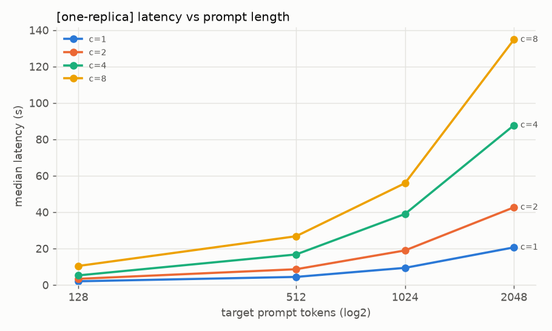
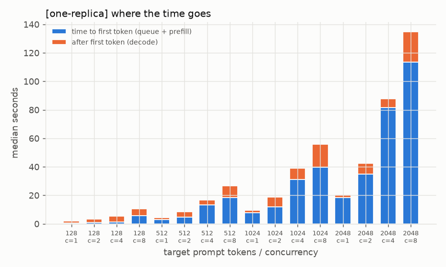
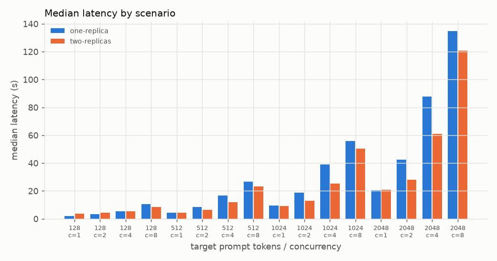
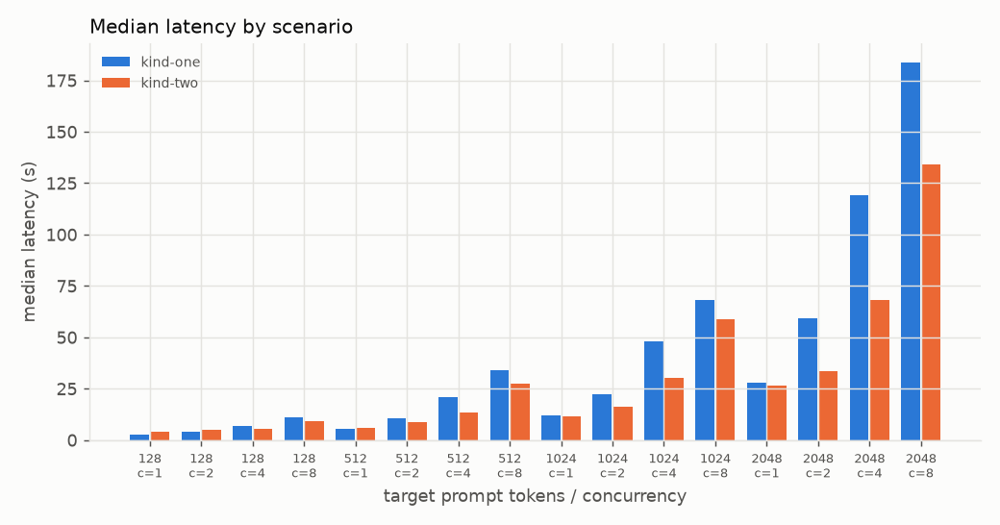
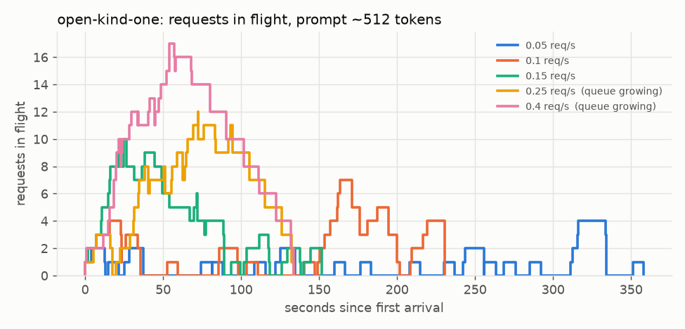
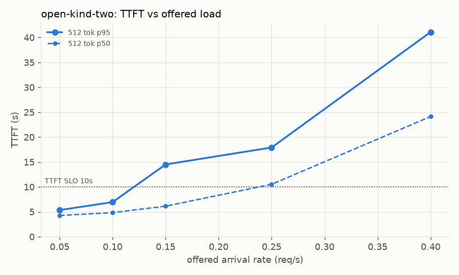

# llm-serving-loadlab

**Is your LLM slow because of load, or because of prompt length?** A small, reproducible
load-test + analysis kit that answers that question with data, and turns the answer into a
one-page decision memo.

## The problem

"The chatbot is slow" usually triggers the reflex of scaling whatever sits in front of the
model: the API gateway, the auth service, the ingress. If the time is actually spent *inside*
the model server, that changes nothing.

LLM latency has two very different phases:

- **Prefill**: the whole prompt is processed in one compute-heavy pass. Its cost grows with
  prompt length (long system prompts, RAG context, chat history).
- **Decode**: output tokens are generated one at a time.

Time to first token (TTFT) = queueing + prefill. If latency grows with *prompt length* and most
of it is TTFT, the bottleneck is prefill on the serving device, and the fix is more serving
capacity (another model replica on idle hardware) or less prefill work, not more gateway pods.

This repo reproduces that diagnostic method with public models on a laptop.

## Method

1. **Controlled load test** (`loadlab/loadgen.py`): async, streaming, OpenAI-compatible.
   Runs a full factorial matrix *prompt length x concurrency* (closed loop: exactly `c`
   requests in flight). Per request: TTFT, total latency, decode tokens/s, prompt and
   completion tokens (from the server's `usage`). Every prompt starts with a unique nonce so
   prefix caching cannot hide prefill cost. Output: CSV + JSON with run metadata.
2. **Analysis** (`loadlab/analyze.py`): per scenario, fit
   `log(latency) = a + e_p*log(prompt_tokens) + e_c*log(concurrency)`.
   The coefficients are elasticities ("2x prompt -> 2^e_p x latency"). The design is balanced,
   so the variance each factor explains alone is directly comparable. It also reports the TTFT
   share of latency and the **throughput gain** from 1 to max concurrency (~1.0 = the device is
   saturated, extra requests just queue). Charts (PNG) + `decision_memo.md`.
3. **Intervention**: run the same matrix against two replicas on separate (idle) compute and
   compare.
4. **Open loop** (`loadgen --mode open`, `loadlab/openloop.py`): requests arrive at a fixed average
   rate as a Poisson process, whether or not earlier ones finished. Shows at which arrival rate the
   queue starts to build up, which is the number capacity planning needs.

## Results (real run on this machine)

All numbers below come from `results/real/` and were produced by the code in this repo on
2026-10-28. Nothing is extrapolated.

**Setup.** No GPU available, so this is a CPU stand-in for "one accelerator":

| | |
|---|---|
| Hardware | Laptop, AMD Ryzen 7 7735HS (8 cores / 16 threads), 13 GB RAM, no GPU |
| Engine | Ollama 0.6.8 (llama.cpp), `OLLAMA_NUM_PARALLEL=4`, context 8192 |
| Model | `qwen2.5:0.5b` (Q4_K_M, public) |
| one-replica | one Ollama container pinned to CPUs 0-7 (CPUs 8-15 idle) |
| two-replicas | + a second container pinned to CPUs 8-15, client-side round robin |
| Matrix | prompt ~128/512/1024/2048 tokens x concurrency 1/2/4/8, 8 requests per cell, `max_tokens=64` |
| Requests | 128 per scenario, **0 errors** in both |

**Finding (one-replica)** — from `results/real/analysis/decision_memo.md`:

| driver | elasticity of latency | variance explained alone (R², log) |
|---|---|---|
| prompt length | 1.00 (2x prompt -> 2.0x latency) | 0.65 |
| concurrency | 0.84 (2x in-flight -> 1.8x latency) | 0.32 |

- With **one request in flight** (no queue), going from ~147 to ~1878 prompt tokens moves
  median latency from 1.99 s to 20.61 s. The cost exists without any load.
- At the longest prompt, **87%** of latency is TTFT (queue + prefill). TTFT elasticity to prompt
  length is 1.40 (super-linear: attention cost on CPU).
- Throughput changes by **x1.00** from 1 to 8 in-flight requests: the device is saturated;
  extra concurrency only adds waiting time. That is why concurrency *looks* like a driver too:
  requests queue behind other requests' prefill.
- Verdict produced by the analyzer: **`prefill`**.




**Intervention (two-replicas on the idle cores):**

- Throughput at concurrency 8: **x1.49** (median over prompt lengths).
- Median p50 latency speedup where more than one request is in flight: **x1.28**; at
  concurrency 1 there is no gain (x1.00 for 512-2048 tokens), as expected.
- Not x2: both replicas share one laptop chip (memory bandwidth, L3 cache, power/thermal
  budget). On separate GPUs/nodes the gain should be closer to linear; that is **not measured here**.
- Noise: the 128-token cells were *slower* in the two-replica run (e.g. 128x1: 1.99 s -> 3.75 s,
  with replica A itself at 4.05 s vs 1.99 s earlier). These are 8-request cells on a laptop with
  other containers running; treat single cells as noisy and look at the trend.



Full per-cell table: `results/real/analysis/cell_summary.csv`. Raw requests:
`results/real/one-replica.csv`, `results/real/two-replicas.csv`.

### Mock demo (simulated, not a model)

`results/mock/` contains output from `loadlab/mock_server.py`, a **simulated** server that
sleeps according to a parametric prefill/decode model. It exists for tests and for running the
pipeline without a model. Its numbers are not results and are labelled MOCK in the memo.

## What I'd tell the customer

> We measured instead of guessing. Response time grows with how much text each request sends
> to the model, and it does so even when only one user is active. Most of the waiting happens
> before the first word appears, while the model reads the prompt. The model server is already
> fully busy: sending it more requests at once does not get more work done, it only makes
> everyone wait longer.
>
> So scaling the services in front of the model (gateway, authentication) will not help, they
> are not where the time goes. What helps, in order:
> 1. Put a second model replica on hardware that is currently idle, behind the same service
>    (in our test: ~1.5x more requests per second under load).
> 2. Send less text per request: cap retrieved context, shorten system prompts, enable prefix
>    caching for the shared part.
> 3. Watch time-to-first-token by prompt size, and scale on queue length, not CPU.

## How to run

```bash
make venv          # creates .venv and installs requirements.txt
make test          # pytest (uses the mock server, no model needed)
make mock-demo     # full pipeline against the simulated server -> results/mock/

# Real run (Docker, ~400 MB model pull, CPU-only is fine; took ~40 min for both scenarios on the laptop above)
make ollama-up     # two Ollama containers pinned to CPUs 0-7 and 8-15, pulls qwen2.5:0.5b
make run-one       # one-replica scenario  -> results/real/one-replica.{csv,json}
make run-two       # two-replicas scenario -> results/real/two-replicas.{csv,json}
make analyze       # charts + decision memo -> results/real/analysis/
make ollama-down
```

Open loop (Poisson arrivals at fixed req/s) and the kind variant:

```bash
make mock-open     # open loop against the simulated server -> results/mock/analysis-openloop/
.venv/bin/python -m loadlab.loadgen --mode open --base-url http://127.0.0.1:11501/v1 --model qwen2.5:0.5b \
  --prompt-lengths 512 --rates 0.05,0.1,0.15,0.25,0.4 --requests-per-cell 24 --scenario open-one --out results/x/open-one
.venv/bin/python -m loadlab.openloop results/x/open-one.csv --out-dir results/x/analysis-openloop --slo-ttft 10

# kind: separate cluster "loadlab" with its own kubeconfig (.kind-kubeconfig); no other cluster is touched
make kind-create MODEL_DIR=/abs/path/with/models   # dir containing models/manifests + models/blobs
make kind-load kind-up kind-forward kind-run-one
make kind-two kind-forward kind-run-two kind-run-open kind-analyze
make kind-down kind-delete
```

Any OpenAI-compatible server works (vLLM, SGLang, llama.cpp server, TGI with the OpenAI API):

```bash
.venv/bin/python -m loadlab.loadgen --base-url http://HOST:8000/v1 --model Qwen/Qwen2.5-0.5B-Instruct \
  --prompt-lengths 128,512,1024,2048,4096 --concurrency 1,2,4,8,16 --requests-per-cell 16 \
  --scenario vllm-1gpu --out results/vllm/one
.venv/bin/python -m loadlab.analyze results/vllm/one.csv --out-dir results/vllm/analysis
```

Note: `prompts.py` calibrates prompt length for the Qwen2.5 tokenizer; for other models the
target length is approximate, but the analysis always uses the server-reported `prompt_tokens`.

## Kubernetes on kind (real run, `results/real-k8s/`)

Same experiment, same matrix, but the model servers are pods in a local kind cluster.
All numbers below come from `results/real-k8s/` (2026-10-28). Nothing is extrapolated.

**Setup.**

| | |
|---|---|
| Cluster | kind v0.27.0, `kindest/node:v1.32.2`, **one node** (see "what did not work") |
| "One accelerator" | a Guaranteed pod with `cpu: 6` (requests = limits) under the kubelet **static CPU manager** (`reservedSystemCPUs: 0-1`): the pod gets 6 *exclusive* logical CPUs = 3 physical cores |
| one replica (`kind-one`) | pod A on CPUs 2-7 |
| two replicas (`kind-two`) | + pod B on CPUs 8-13 (checked in `/var/lib/kubelet/cpu_manager_state` and in each pod's `Cpus_allowed_list`) |
| Engine / model | Ollama 0.6.8, `qwen2.5:0.5b` with `num_thread 6`, `OLLAMA_NUM_PARALLEL=4` |
| Model files | no download: the existing local copy (~400 MB) is mounted read-only into the node, an init container copies it into an emptyDir |
| Traffic | `kubectl port-forward` to each pod, client-side round robin (the Service could not be used, see below) |
| Matrix | identical to the Docker run: 4 prompt lengths x concurrency 1/2/4/8, 8 requests per cell, 128 requests per scenario, **0 errors** |

Because each replica has 6 logical CPUs here (8 in the Docker run), absolute seconds are not
comparable between the two runs; the ratios are.

**Finding (`kind-one`)** — from `results/real-k8s/analysis/decision_memo.md`:

| driver | elasticity of latency | variance explained alone (R², log) |
|---|---|---|
| prompt length | 1.04 (2x prompt -> 2.06x latency) | 0.67 |
| concurrency | 0.83 (2x in-flight -> 1.77x latency) | 0.29 |

- One request in flight, ~147 -> ~1878 prompt tokens: median latency 2.55 s -> 27.81 s.
- At the longest prompt **88%** of latency is TTFT. Throughput from 1 to 8 in flight: **x1.02** (saturated).
- Verdict: **`prefill`**, the same as the Docker run.

**Intervention (`kind-two`, second pod on the idle cores):**

- Throughput at concurrency 8: **x1.60** (median over prompt lengths; Docker run: x1.49).
- Median p50 latency speedup where more than one request is in flight: **x1.31** (Docker run: x1.28).
  At concurrency 1 no gain for 512-2048 tokens (x0.97-x1.05), as expected.
- Noise, reproduced from the Docker run: the 128-token cells got *slower* with two replicas
  (128x1: x0.60). Split by pod, the slow one is pod A, the pod that had just served the whole
  `kind-one` matrix (128x1 median 5.48 s vs 2.65 s on the fresh pod B; it was 2.55 s in
  `kind-one`). The Docker run showed the same pattern on its replica A. The cause is **not
  identified**; leftover state in the warm replica is a guess, not a measurement.



**Background load.** `results/real-k8s/host_load.log` samples per-container CPU every 30 s. Another
project's Ollama container was busy (~7 cores) until 12:28 UTC; all runs started at or after 12:33 UTC,
and the log shows no comparable load during them. Other light containers (n8n, a scraper, a separate
3-node kind cluster) kept running. Kubernetes exclusive CPUs only keep *pods* off the cores; host
processes can still run there.

**What did not work, and why (honest list).**

- **Three nodes (control plane + 2 workers) did not start.** containerd's CRI plugin failed with
  `failed to create fsnotify watcher: too many open files`: the host's `fs.inotify.max_user_instances`
  is 128 and is shared with a 3-node kind cluster already running on the laptop. Raising it needs
  `sudo sysctl`, which was out of scope. Hence one node, and the static CPU manager instead of one
  node per "accelerator". `topologySpreadConstraints` (one replica per node) is therefore not exercised.
- **kube-proxy crash-looped on that node** for the same reason (`too many open files`), so
  Services/NodePort did not route and CoreDNS never became ready. The load went through
  `kubectl port-forward` per pod with client-side round robin. **Service load balancing was not
  measured.** Note for a real cluster: kube-proxy balances *connections*, not requests; the load
  generator has `--no-keepalive` for that case.
- `kind load docker-image` failed (`content digest ... not found`, Docker's containerd image store with
  a multi-arch image); `docker save --platform linux/amd64` + `kind load image-archive` worked
  (`make kind-load`).

**Kubernetes pitfalls this run actually hit** (each one changed the numbers or the isolation):

1. An init container *without* resources made the pod `Burstable`, and the static CPU manager gave it
   no exclusive CPUs (`Cpus_allowed_list: 0-15`). Every container, init included, needs requests = limits.
2. llama.cpp sized its thread pool from the host (`--threads 8`) inside a 6-CPU pod. The kind overlay
   re-creates the model with `PARAMETER num_thread 6` (same weights). On vLLM/GPU the equivalent is
   making sure the engine sees the device limits it is given.

## Open loop: when does the queue start to grow? (real run on kind)

`loadgen --mode open` sends requests at a fixed average rate (Poisson arrivals) regardless of whether
earlier ones finished; `loadlab/openloop.py` turns that into a queue build-up chart and a memo.
Run on the kind setup above, prompt ~512 tokens, 24 requests per rate, rates 0.05 / 0.1 / 0.15 /
0.25 / 0.4 req/s, same seeded arrival schedule for both scenarios. 240 requests, **0 errors**.
Source: `results/real-k8s/analysis-openloop/openloop_memo.md`.

| offered req/s | one pod: completed req/s | one pod: TTFT p50 / p95 | two pods: completed req/s | two pods: TTFT p50 / p95 |
|---|---|---|---|---|
| 0.05 | 0.067 | 4.99 s / 11.71 s | 0.067 | 4.27 s / 5.35 s |
| 0.10 | 0.104 | 7.04 s / 18.06 s | 0.105 | 4.83 s / 6.94 s |
| 0.15 | 0.158 | 6.91 s / 33.07 s | 0.158 | 6.13 s / 14.51 s |
| 0.25 | 0.180 (queue growing) | 21.67 s / 41.13 s | 0.231 (queue growing) | 10.52 s / 17.91 s |
| 0.40 | 0.179 (queue growing) | 43.73 s / 71.68 s | 0.233 (queue growing) | 24.13 s / 41.10 s |

- One pod tops out at **~0.18 req/s** completed, two pods at **~0.23 req/s**; above that, offered
  load just becomes queue (peak in flight 17 and 15 requests at 0.4 req/s). One pod's ceiling matches
  its closed-loop throughput at 512 tokens (0.177-0.193 req/s); two pods stay below their closed-loop
  0.29 req/s at c=8.
- With a p95 TTFT SLO of 10 s: two pods hold it up to **0.1 req/s** of the tested rates; one pod does
  not hold it at any tested rate (p95 11.71 s already at 0.05 req/s). The second replica is what
  makes the SLO reachable at all, not only what raises the ceiling.
- Noise: 24 requests per rate is small. The 0.15 req/s cells are flagged "stable" by the heuristic
  (an early burst drained later, so the backlog trend is negative) while their p95 TTFT is already 33 s
  on one pod; treat 0.15 as the edge, not as safe. The "realised arrivals" column in the memo is
  estimated from first-to-last arrival and reads high for 0.05 (0.065); the schedule itself has exactly
  24 arrivals in 480 s.
- A first attempt used unconditioned exponential gaps; with 20 requests per rate the realised rate missed
  the target badly (0.4 offered came out as 0.27). The generator now draws the arrivals as a Poisson
  process conditioned on the count. The superseded raw files are kept in `results/real-k8s/superseded/`
  and are not used in any number above.




During `open-kind-one` the second pod was running but received no traffic (it uses its own exclusive CPUs).

## Planned / not done

- GPU run with vLLM (needs an NVIDIA GPU; this machine has none).
- Multi-node kind / real cluster run with Service load balancing (blocked here by the host inotify
  limit, see the Kubernetes section; the overlays `k8s/overlays/one-replica|two-replicas` are the
  multi-node version, still not benchmarked).
- Open-loop runs at other prompt lengths and with longer cells (the real open-loop run uses one
  prompt length, 24 requests per rate).
- Larger closed-loop cells (more requests per cell) to tighten the noisy short-prompt measurements.

## Layout

```
loadlab/prompts.py      unique, length-controlled prompts (defeats prefix cache)
loadlab/loadgen.py      async streaming load generator -> CSV/JSON
loadlab/analyze.py      elasticities, throughput, charts, decision memo
loadlab/openloop.py     open-loop analysis: queue build-up, TTFT vs offered rate, memo
loadlab/mock_server.py  SIMULATED OpenAI-compatible server (tests / offline demo)
k8s/                    kustomize base, one/two replica overlays (multi-node), kind-one/kind-two
                        overlays (benchmarked), kind cluster config, HPA note
tests/                  pytest
results/real/           real run on this machine, Docker (raw + analysis)
results/real-k8s/       real run on kind: closed loop + open loop (raw, logs, analysis, host load log)
results/mock/           mock demo output
docs/WALKTHROUGH.md     design notes (Turkish)
```

## License

MIT
